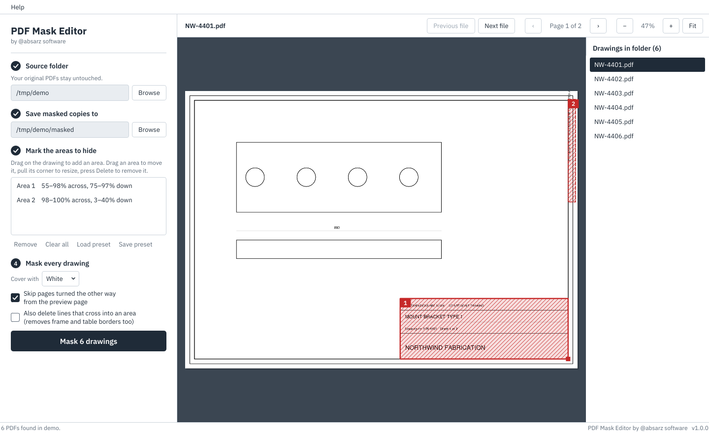

# PDF Mask Editor

**by @absarz software**

Hide areas on the sheets of an engineering drawing set: the title block, client logo or
ownership notice. Mask one multi-page PDF into one masked PDF, or a whole folder in one pass.
When the title block moves part way through a file, give each run of pages its own layout.



## What it does

- Draw the areas to hide on a preview of the drawing. Move and resize them with the mouse.
- **One file** (default): one PDF with many pages in, one masked PDF with all its pages out.
  **Folder**: every PDF in a folder, one output per input. Switch at the top of the sidebar.
- **Layouts** group pages that have the areas in the same place, for example pages 1-30 and
  35-40 in one layout and 31-33 in another. A page that belongs to no layout is copied unchanged.
- Text and images inside an area are **deleted**, not just covered, so they can't be
  copied, searched or extracted afterwards. PDF metadata is cleared too.
- Originals are never changed, and the app asks before replacing an existing output file.
- Save the layouts as a preset and reuse them. Presets from version 1.0 still load.
- Runs entirely on your computer. Nothing is uploaded.

## Run from source

Requires Python 3.10 or newer.

```bash
git clone https://github.com/<your-username>/pdf-mask-editor.git
cd pdf-mask-editor
python -m venv .venv
.venv\Scripts\activate          # macOS/Linux: source .venv/bin/activate
pip install -r requirements.txt
python main.py
```

## Build the Windows app

Double-click `build.bat`. It creates a virtual environment, runs the tests and builds
`dist\PDFMaskEditor.exe`, a single file that runs without Python installed.

Pushing a tag such as `v1.1.0` to GitHub builds the `.exe` automatically and attaches
it to the release (see `.github/workflows/build.yml`).

## How to use

1. **Drawing file**: choose a PDF with Browse, or drop it on the window.
2. **Save masked copy as**: defaults to `<name>_masked.pdf` next to the original. Change it
   with Browse (Save As). Your original is never overwritten.
3. **Mark the areas to hide**: drag on the drawing. Drag an area to move it, pull its corner
   to resize, press Delete to remove it. Areas go into the layout that covers the current page.
4. **Mask this drawing**: choose a white or black cover and press the button.

In Folder mode, step 1 is the source folder, step 2 the output folder, and the button masks
every PDF in it.

Spot-check the output: try to select or search text inside a masked area.

### When the title block moves

Say a 40-page drawing has the title block in one place on pages 1-30 and 35-40, somewhere
else on pages 31-33, and somewhere else again on page 34.

1. Draw the areas on page 1. This creates **Layout 1** for every page.
2. Go to page 31 and press **Start a new layout at this page**. Pages 31-40 move to a new
   layout with a copy of the areas. Move and resize them to the new position.
3. Go to page 34 and do the same.
4. Page 35 is back to the original position, so edit Layout 1's page range to `1-30, 35-40`
   and remove the layout that held 35-40.

The strip under the toolbar shows one cell per page. Neutral tones tell layouts apart, a red
bar marks pages that will be masked, and a dashed hatched cell is a page with no layout.
Click a cell to open that page.

Page ranges accept `1-30`, `34`, `1-30, 35-40` and `35-end`. Layouts can't share a page.
Before masking, the app lists pages that no layout covers and lets you go back or mask anyway.

### Options

| Option | Default | Effect |
| --- | --- | --- |
| Skip pages turned the other way | On | Pages in a different orientation from the page a layout was drawn on are copied unchanged, because the areas would land in the wrong place. |
| Also delete lines that cross into an area | Off | Off keeps drawing frames and table borders that pass through an area (they are painted over). On deletes them from the file completely. |

### Shortcuts

| Keys | Action |
| --- | --- |
| Ctrl+O | Open drawing file (or folder) |
| Ctrl+S | Save masked copy as |
| Ctrl+1 / Ctrl+2 | One file / Folder |
| Ctrl+Z | Remove last area |
| Delete | Remove selected area |
| Ctrl+L | Start a new layout at this page |
| Ctrl+scroll, Ctrl+0 | Zoom, fit page |
| Middle-drag or Alt+drag | Pan |
| Page Up / Page Down | Change page |
| Ctrl+Enter | Mask |

## Project layout

```
pdfmask/
  core.py         redaction engine (no UI, unit-tested)
  canvas.py       preview where areas are drawn
  pagestrip.py    one cell per page, coloured by layout
  main_window.py  main window
  splash.py       splash screen
  theme.py        colours, type and stylesheet
  worker.py       background masking thread
assets/           icon, fonts
tests/            pytest suite
```

Run the tests with `pytest`.

## Licence

Code: MIT, see `LICENSE`.
PyMuPDF is AGPL-3.0 (or commercial from Artifex); a distributed build that bundles it
must follow those terms. IBM Plex Sans is under the SIL Open Font License.
